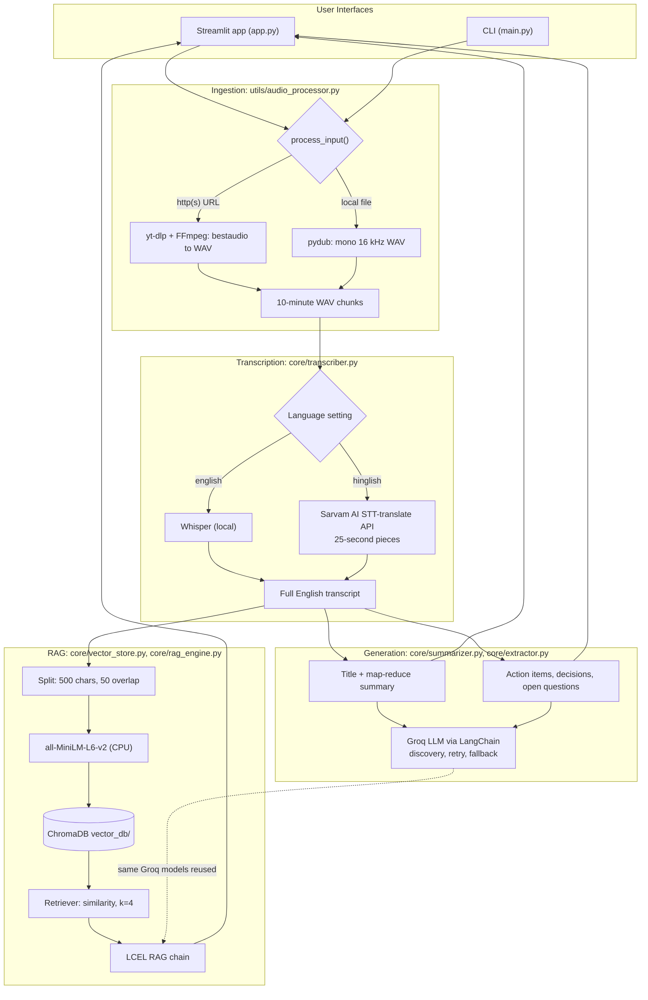
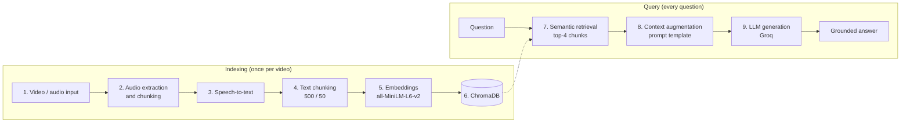
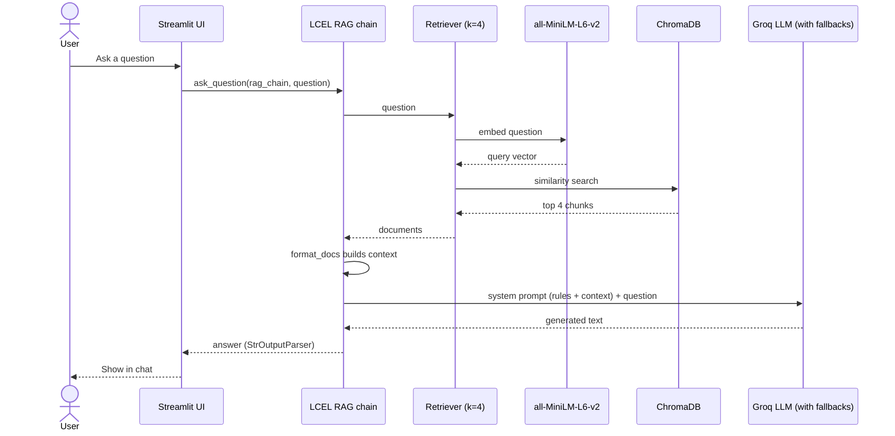

<p align="center">
  <a href="https://ai-video-assistant-d5a2u5rax5hcwycxzvmdcq.streamlit.app/"></a><br>
  <b>Live demo:</b> <a href="https://ai-video-assistant-d5a2u5rax5hcwycxzvmdcq.streamlit.app/">https://ai-video-assistant-d5a2u5rax5hcwycxzvmdcq.streamlit.app/</a>
</p>

<h1 align="center">AI Video Assistant</h1>

<p align="center"><b>Transcribe, summarise and chat with any video using a Retrieval-Augmented Generation (RAG) pipeline.</b></p>

<div align="center">

    
    

</div>

**Contents:** [Overview](#overview) · [Problem](#problem-statement) · [Features](#key-features) · [Architecture](#system-architecture) · [RAG Pipeline](#rag-pipeline) · [RAG Concepts](#rag-technical-concepts) · [Tech Stack](#technology-stack) · [Structure](#project-directory-structure) · [How It Works](#how-it-works) · [Setup](#installation-and-setup) · [Env Vars](#environment-variables) · [Run](#how-to-run) · [Examples](#example-queries-and-output) · [Live Demo](#live-demo) · [Engineering](#technical-challenges-and-engineering-decisions) · [Evaluation](#rag-evaluation) · [Limitations](#current-limitations) · [Future Work](#future-improvements) · [Skills](#skills-demonstrated) · [Contributing](#contributing) · [License](#license)

---

## Overview

- **Input to transcript:** a YouTube URL or uploaded file (`mp3, wav, m4a, aac, ogg, flac, mp4, mkv, webm, mov`; 500 MB upload limit in `.streamlit/config.toml`), transcribed by local **Whisper** (English) or **Sarvam AI** (Hindi / Hinglish, translated to English).
- **Output:** title, bullet summary, action items, key decisions, open questions, plus downloadable report (`.md`) and transcript (`.txt`).
- **Chat:** a **RAG chain** over ChromaDB that answers only from the transcript.
- **Interfaces and status:** Streamlit app (`app.py`) and CLI (`main.py`). Working prototype, [deployed on Streamlit Community Cloud](https://ai-video-assistant-d5a2u5rax5hcwycxzvmdcq.streamlit.app/), not production-hardened.

## Problem Statement

- Long videos (lectures, interviews, talks, meetings) are slow to review and hard to search.
- Real-world audio often mixes Hindi and English, which English-only speech models handle poorly.
- A general LLM asked about an unseen video will guess. RAG grounds answers in the actual transcript.

## Key Features

| Feature | Description |
|---|---|
| Two transcription engines | Whisper (local, English) and Sarvam AI (Hindi / Hinglish to English) |
| Map-reduce summarisation | Summarise parts, merge, compress, then write the final summary |
| Structured insights | Action items (task, owner, deadline), key decisions, open questions |
| Grounded RAG chat | Top-4 semantic retrieval from ChromaDB, answer restricted to retrieved context |
| Resilient LLM layer | Groq model discovery, throttling, retries with backoff, model fallback, local fallback summary and title |

---

## System Architecture



## RAG Pipeline



| # | Stage | Module | What happens |
|---|---|---|---|
| 1 | Input | `app.py`, `main.py` | URL (`http://` or `https://`) is downloaded; anything else is treated as a local file. Uploads are saved to `uploads/` |
| 2 | Audio processing | `utils/audio_processor.py` | URLs: `yt-dlp` + FFmpeg to WAV. Files: `pydub` to mono 16 kHz WAV. Then split into **10-minute chunks** |
| 3 | Transcription | `core/transcriber.py` | `english`: Whisper (default `small`, `task="transcribe"`). `hinglish`: Sarvam `speech-to-text-translate` (default `saaras:v2.5`), each chunk cut into **25 s pieces** |
| 4 | Text chunking | `core/vector_store.py` | `RecursiveCharacterTextSplitter`, `chunk_size=500`, `chunk_overlap=50`, each chunk a `Document` with `chunk_index` metadata |
| 5 | Embeddings | `core/vector_store.py` | `HuggingFaceEmbeddings`, `all-MiniLM-L6-v2` on CPU, loaded once |
| 6 | Vector storage | `core/vector_store.py` | ChromaDB collection `meeting_transcript` in `vector_db/`; deleted and rebuilt for every new video |
| 7 | Retrieval | `core/vector_store.py` | `as_retriever(search_type="similarity", search_kwargs={"k": 4})` |
| 8 | Context augmentation | `core/rag_engine.py` | `format_docs` joins chunks into `{context}` of a system prompt that restricts answers to the transcript |
| 9 | Generation | `core/rag_engine.py` | `ChatGroq` with other discovered models as `with_fallbacks`, parsed by `StrOutputParser` |



---

## RAG Technical Concepts

- **Chunking:** `RecursiveCharacterTextSplitter`, sizes in characters: 500 / 50 for retrieval, 6,000 / 200 for summarisation. The transcript has few paragraph breaks, so splits mostly fall on spaces. Semantic or sentence-aware chunking is not implemented.
- **Embeddings:** `all-MiniLM-L6-v2` (384-dim) runs locally on CPU. The same model embeds chunks and questions, which keeps their vectors comparable.
- **Vector search:** ChromaDB `similarity` search. No custom distance metric is set, so Chroma's default applies.
- **Retrieval:** `k=4`, fixed in code, so context is at most about 4 x 500 = 2,000 characters. Not implemented: reranking, MMR, hybrid search, score thresholds, metadata filtering. The retriever sees only the current question, not chat history.
- **Context augmentation:** `format_docs` fills `{context}` in a system prompt that says to answer ONLY from the context, otherwise reply *"I could not find this information in the video transcript."*
- **Generation:** `ChatGroq` with `temperature=0.3`, `timeout=90`, `max_retries=1`, fallback models and a friendly message on failure. Grounding reduces but does not eliminate hallucination; there is no citation or answer-verification step.
- Chunk sizes and `k` are starting values. No tuning experiments or embedding comparisons are documented (see [RAG Evaluation](#rag-evaluation)).

```python
{"context": retriever | RunnableLambda(format_docs),
 "question": RunnablePassthrough()}
| prompt | get_llm() | StrOutputParser()
```

---

## Technology Stack

| Technology | Purpose |
|---|---|
| **Python 3.10+** | Core language |
| **Streamlit** | Web UI: sidebar inputs, live progress, tabs, chat, downloads |
| **yt-dlp**, **pydub**, **FFmpeg** | Download YouTube audio, convert to WAV, resample and chunk (FFmpeg is installed separately) |
| **OpenAI Whisper** + **PyTorch** | Local English speech-to-text |
| **Sarvam AI API** | Hindi / Hinglish speech-to-text with translation to English |
| **LangChain** (`core`, `text-splitters`, `groq`, `chroma`, `huggingface`) | Prompts, LCEL chains, splitting, retriever and integrations |
| **Groq API** (`ChatGroq`) | LLM inference for summaries, insights and RAG answers |
| **ChromaDB** | Local persistent vector store |
| **sentence-transformers** (`all-MiniLM-L6-v2`) | Text embeddings |
| **requests**, **python-dotenv** | Sarvam and Groq model-list HTTP calls; loading API keys from `.env` |

## Project Directory Structure

```text
AI-Video-Assistant/
├── .streamlit/config.toml   # Dark theme, 500 MB upload limit
├── core/
│   ├── extractor.py         # Action items, decisions, open questions
│   ├── rag_engine.py        # LCEL RAG chain, grounded prompt, ask_question()
│   ├── summarizer.py        # Groq discovery, throttle/retry, map-reduce summary, title
│   ├── transcriber.py       # Whisper and Sarvam AI transcription
│   └── vector_store.py      # Chunking, embeddings, ChromaDB, retriever
├── utils/audio_processor.py # YouTube download, WAV conversion, audio chunking
├── app.py                   # Streamlit app (run_analysis())
├── main.py                  # CLI entry point (run_pipeline())
├── check_setup.py           # Environment and setup validator
├── packages.txt             # System package: ffmpeg
└── requirements.txt         # Python dependencies
```

Git-ignored folders created at runtime: `uploads/`, `downloades/` (spelled this way in the code) and `vector_db/`. Your `.env` is also git-ignored.

## How It Works

1. **Ingest and transcribe.** The input becomes 10-minute WAV chunks, each transcribed by Whisper or Sarvam. An empty transcript raises a clear "no speech detected" error.
2. **Title and summary.** The title uses the first 2,000 characters. The summary splits the transcript into 6,000-character chunks (200 overlap): one chunk is summarised directly, several go through **map-reduce** (summarise each part, merge, compress while the merge exceeds 12,000 characters, then write the final bullet summary).
3. **Insights.** Three prompts extract action items (task, owner, deadline), key decisions and open questions from the first 12,000 characters.
4. **Index, chat and UI.** The transcript is chunked, embedded and stored in ChromaDB, and the LCEL chain is kept in `st.session_state`. The UI shows metrics (words, reading time, audio chunks, processing time), Summary / Insights / Transcript tabs, downloads, suggested questions and chat.
5. **LLM reliability layer** (`core/summarizer.py`, reused by `rag_engine.py`):
   - Discovers available Groq models via `/models` (fallback: `llama-3.3-70b-versatile`, `llama-3.1-8b-instant`), filters out non-chat models, orders by preferred names and tries up to 4.
   - Enforces a 1.5 s gap between calls, retries rate limits with exponential backoff (3 attempts per model) and skips failing models.
   - If every model fails, `summarize()` and `generate_title()` use simple local fallbacks.

---

## Installation and Setup

**Prerequisites:** Python 3.10+, **FFmpeg** on your `PATH` (macOS `brew install ffmpeg`, Ubuntu `sudo apt install ffmpeg`, Windows: install a build and add `bin` to `PATH`), a **Groq API key**, and a **Sarvam AI key** (only for `hinglish` mode).

```bash
git clone https://github.com/naveenkumar-analytics/AI-Video-Assistant.git
cd AI-Video-Assistant
python -m venv .venv
.venv\Scripts\activate          # macOS / Linux: source .venv/bin/activate
pip install -r requirements.txt
python check_setup.py           # optional: verifies packages, keys and a live Groq call
```

The first run downloads the Whisper and `all-MiniLM-L6-v2` models, so it needs internet and takes longer.

## Environment Variables

Create a `.env` file in the project root. **Never commit it** (it is git-ignored).

```env
GROQ_API_KEY=your_groq_api_key_here
SARVAM_API_KEY=your_sarvam_api_key_here
# Optional overrides: WHISPER_MODEL, SARVAM_STT_MODEL
```

| Variable | Required | Default | Purpose |
|---|---|---|---|
| `GROQ_API_KEY` | Yes | none | Summaries, insights and RAG answers |
| `SARVAM_API_KEY` | Only for `hinglish` | none | Sarvam speech-to-text-translate |
| `WHISPER_MODEL` | No | `small` | Whisper model size |
| `SARVAM_STT_MODEL` | No | `saaras:v2.5` | Sarvam model name |

## How to Run

```bash
streamlit run app.py     # web app, usually http://localhost:8501
python main.py           # CLI: prompts for URL/path and language, then a chat loop (exit, quit or q to leave)
```

**Live app:** [https://ai-video-assistant-d5a2u5rax5hcwycxzvmdcq.streamlit.app/](https://ai-video-assistant-d5a2u5rax5hcwycxzvmdcq.streamlit.app/) (an idle app may take a moment to wake up). The app is deployed on Streamlit Community Cloud. `packages.txt` installs FFmpeg, and API keys must be provided through the platform's secrets settings, never committed.

---

## Example Queries and Output

| Example query | Expected behavior |
|---|---|
| "What is the main message of this video?" | Answer built from the retrieved transcript chunks |
| "Summarize the key points in 3 bullets." | Short bulleted answer from the retrieved context |
| "What advice does the speaker give?" | Advice found in the retrieved chunks |
| "Who is speaking and what is the topic?" | Answers only if the transcript says so |
| A question the video does not cover | The prompt instructs: *"I could not find this information in the video transcript."* |

**CLI flow** (`main.py`):

| Step | Console text |
|---|---|
| Prompts | `Enter YouTube URL or local file path:` then `Language (english/hinglish):` |
| Progress logs | `Detected YouTube URL. Downloading audio...`, `Chunking audio...`, `Using Whisper for transcription.`, `Building vector Store` |
| Results | Title, Summary, Action Items, Key Decisions and Open Questions, each printed under its own heading |
| Chat | `Chat with your meeting (type 'exit' to quit)`, then `You:` prompts answered as `Assistant:` |

The Streamlit app shows live progress steps (preparing audio, transcribing, generating title, writing summary, extracting action items, key decisions and open questions, building the chat index). The downloaded report contains Title, Summary, Action Items, Key Decisions, Open Questions and Transcript. Generated text varies with the video and the Groq model.

---

## Live Demo

**Try it:** [https://ai-video-assistant-d5a2u5rax5hcwycxzvmdcq.streamlit.app/](https://ai-video-assistant-d5a2u5rax5hcwycxzvmdcq.streamlit.app/)

1. Open the app (an idle app may take a moment to wake up).
2. Choose **YouTube URL** or **Upload file**, pick `english` or `hinglish`, and click **Analyse video**.
3. Watch the live progress, then browse the **Summary**, **Insights** and **Transcript** tabs and download the report.
4. Ask questions in the chat, or click one of the suggested questions.

Tips: use short videos on the free hosting tier, and avoid sensitive content because the deployed app keeps one shared index at a time.

---

## Technical Challenges and Engineering Decisions

| Challenge | Decision implemented in code |
|---|---|
| Long videos exceed speech and LLM limits | 10-minute audio chunks; map-reduce summaries with repeated compression under 12,000 characters |
| Sarvam's sync API accepts only short audio | Each chunk is cut into 25-second pieces, sent separately, joined; temporary pieces are deleted after each request |
| Hindi / Hinglish audio | Separate Sarvam path that translates to English, so the downstream pipeline stays English |
| Groq availability and rate limits | Per-key model discovery, throttling, exponential backoff, skipping failed models, `with_fallbacks` in the RAG chain |
| App should survive LLM outages | Local fallback summary and title; default "none found" messages in the extractor |
| Stale data from a previous video | Chroma collection is deleted before each new index; models and clients are loaded lazily once and cached |
| Hallucination | Prompt restricts answers to retrieved context with a fixed "not found" reply |

## RAG Evaluation

> **Quantitative evaluation has not been performed yet.** No retrieval metrics, answer-quality scores, transcription error rates or latency benchmarks have been measured, and none are claimed here.

What exists today is qualitative only: the grounded prompt with a fixed fallback reply, `check_setup.py` (environment check, not quality), and the in-app "Processed in" time (not a benchmark).

| Planned evaluation | Metric |
|---|---|
| Transcription accuracy (Whisper sizes vs Sarvam) | Word Error Rate (WER) on reference clips |
| Retrieval quality | Hit rate / Recall@k, MRR for different `k` and chunk sizes |
| Answer quality | Faithfulness, relevance, correct refusal of unanswerable questions (manual or RAGAS-style) |
| Summary quality | Manual coverage and consistency review |
| System speed | Seconds per minute of audio on stated hardware |

Suggested protocol: pick several videos, write questions with reference answers (including unanswerable ones), log retrieved chunks and answers, then compare settings such as `k`, chunk size, embedding model and MMR or reranking.

## Current Limitations

This is a working prototype, **not production-hardened**.

- **One active video.** The Chroma collection is rebuilt on every analysis and `vector_db/` is shared, so concurrent users or multiple videos are not supported. This matters for the public deployment.
- **No chat memory.** Each question is answered independently; history is displayed but not passed to the chain.
- **Partial insight coverage.** Action items, decisions and questions use only the first 12,000 characters (title: first 2,000).
- **Basic retrieval.** Plain top-4 similarity, no timestamps or source citations.
- **Language handling.** `hinglish` returns English only; `english` mode does not translate other languages.
- **External dependencies.** Needs Groq (and Sarvam for hinglish) keys and internet. Rate limits apply, and a public app shares API quota across visitors.
- **Downloads and hosting.** YouTube downloads depend on yt-dlp and can fail if YouTube changes or blocks requests. Streamlit Community Cloud apps sleep after inactivity and run under shared resource limits, which can affect large videos or the Whisper model.
- **Housekeeping.** Temporary audio files are not cleaned up; no automated tests; no performance benchmarks.

## Future Improvements

- Conversational memory (history-aware retriever), timestamps and source citations
- MMR, hybrid (BM25 + vector) search or a reranker; per-session Chroma collections for multi-user support
- Map-reduce for the insight extractors so the whole transcript is covered
- Streaming responses, temp-file cleanup, unit tests, Dockerfile and CI
- A real evaluation set (see [RAG Evaluation](#rag-evaluation)) and removal of unused dependencies from `requirements.txt`

## Skills Demonstrated

| Area | Where it appears |
|---|---|
| RAG engineering | Chunking, embeddings, ChromaDB, retriever, grounded prompt (`core/vector_store.py`, `core/rag_engine.py`) |
| LangChain LCEL | `RunnablePassthrough`, `RunnableLambda`, prompt, LLM and parser composed with the pipe operator |
| Prompt engineering | Separate prompts for map, final summary, title, extraction and grounded Q&A |
| LLM reliability | Model discovery, throttling, backoff, fallbacks, graceful degradation |
| Speech AI | Local Whisper plus a cloud multilingual STT-translate API |
| Audio and long-context handling | yt-dlp, FFmpeg, pydub chunking; chunked transcription and map-reduce summarisation |
| Application development | Streamlit UI, session state, CLI, Community Cloud deployment |
| Engineering practice | Environment-based config, secrets kept out of Git, setup validation script |

## Contributing

Contributions are welcome: fork the repo, create a branch, push your changes and open a Pull Request. Never commit `.env` files or API keys. [Future Improvements](#future-improvements) is a good place to start.

## License

No license file has been added yet, so all rights are reserved by the author. To open-source the project, add a `LICENSE` file (for example MIT) and update this section.

---

Built by [naveenkumar-analytics](https://github.com/naveenkumar-analytics).
