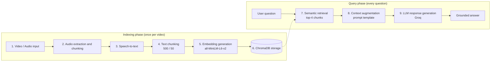
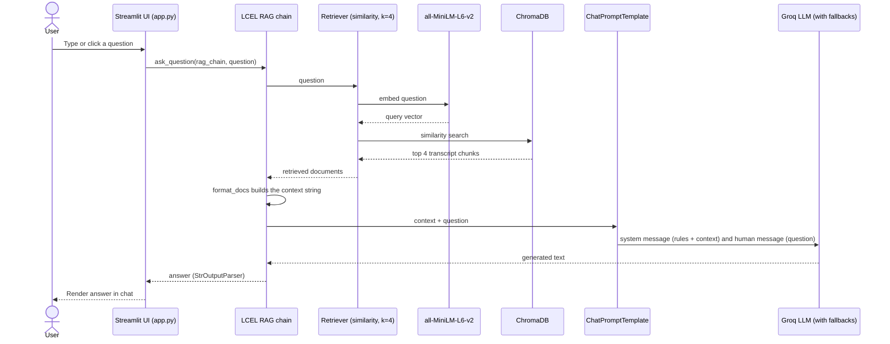

<p align="center">
  
</p>

<h1 align="center">AI Video Assistant</h1>

<p align="center">
  <b>Turn any YouTube video or audio/video file into a transcript, a structured summary, and a grounded Q&amp;A chat, powered by a Retrieval-Augmented Generation (RAG) pipeline.</b>
</p>

<div align="center">


</div>

<p align="center">
  <a href="#quick-start">Quick Start</a> &bull;
  <a href="#screenshots-and-demo">Screenshots</a> &bull;
  <a href="#system-architecture">Architecture</a> &bull;
  <a href="#rag-technical-concepts">RAG Concepts</a> &bull;
  <a href="#rag-evaluation">Evaluation</a> &bull;
  <a href="#installation-and-setup">Installation</a>
</p>

---

## Table of Contents

- [At a Glance](#at-a-glance)
- [Quick Start](#quick-start)
- [Project Overview](#project-overview)
- [Problem Statement](#problem-statement)
- [Key Features](#key-features)
- [System Architecture](#system-architecture)
- [RAG Pipeline](#rag-pipeline)
- [RAG Technical Concepts](#rag-technical-concepts)
- [Technology Stack](#technology-stack)
- [Project Directory Structure](#project-directory-structure)
- [Detailed Working Mechanism](#detailed-working-mechanism)
- [Installation and Setup](#installation-and-setup)
- [Environment Variables](#environment-variables)
- [How to Run](#how-to-run)
- [Example Queries and Expected Behavior](#example-queries-and-expected-behavior)
- [Example Input and Output](#example-input-and-output)
- [Screenshots and Demo](#screenshots-and-demo)
- [Technical Challenges and Engineering Decisions](#technical-challenges-and-engineering-decisions)
- [RAG Evaluation](#rag-evaluation)
- [Current Limitations](#current-limitations)
- [Future Improvements](#future-improvements)
- [Skills Demonstrated](#skills-demonstrated)
- [Contributing](#contributing)
- [License](#license)

---

## At a Glance

| | |
|---|---|
| **What it does** | Converts a YouTube URL or media file into a transcript, summary, insights and a chat that answers from the transcript |
| **Core approach** | RAG: transcript chunks, MiniLM embeddings, ChromaDB, top-4 similarity retrieval, Groq LLM through a LangChain (LCEL) chain |
| **Languages** | English (Whisper, runs locally) and Hindi / Hinglish (Sarvam AI, output translated to English) |
| **Interfaces** | Streamlit web app and command-line interface |
| **Reliability features** | Dynamic Groq model discovery, request throttling, retries with backoff, model fallback, local fallback summary and title |
| **Project status** | Working prototype, not production-hardened (see [Current Limitations](#current-limitations)) |
| **Evaluation** | Qualitative safeguards only. Quantitative RAG evaluation has **not** been performed yet (see [RAG Evaluation](#rag-evaluation)) |

> **For reviewers:** see [Skills Demonstrated](#skills-demonstrated) for a skills-to-code mapping, and [Where to look first](#where-to-look-first-for-reviewers) for a short code tour.

---

## Quick Start

Requires Python 3.10+, [FFmpeg](#prerequisites) on your `PATH`, and a Groq API key.

```bash
git clone https://github.com/naveenkumar-analytics/AI-Video-Assistant.git
cd AI-Video-Assistant
python -m venv .venv
.venv\Scripts\activate          # macOS / Linux: source .venv/bin/activate
pip install -r requirements.txt
# Create a .env file with GROQ_API_KEY (and SARVAM_API_KEY for hinglish mode)
streamlit run app.py
```

Full instructions are in [Installation and Setup](#installation-and-setup) and [Environment Variables](#environment-variables).

---

## Project Overview

**AI Video Assistant** is an end-to-end Generative AI application that converts spoken content in a video or audio file into usable knowledge. Given a YouTube URL or an uploaded media file, it:

1. Extracts and chunks the audio.
2. Transcribes it with **OpenAI Whisper** (English) or **Sarvam AI** (Hindi / Hinglish, translated to English).
3. Generates a title, a bullet-point summary, action items, key decisions and open questions with an LLM served by **Groq**.
4. Indexes the transcript in a **ChromaDB** vector store using **all-MiniLM-L6-v2** embeddings.
5. Lets the user **chat with the video**. Answers are produced by a LangChain (LCEL) RAG chain that is instructed to answer *only* from the retrieved transcript context.

The project can be used through a **Streamlit web app** (`app.py`) or a **command-line interface** (`main.py`).

---

## Problem Statement

Long videos such as lectures, interviews, talks and meetings are slow to review. Watching them end to end, taking notes by hand and searching for a single detail are all time-consuming. Two additional issues make this harder:

- **Mixed-language audio.** Much real-world content mixes Hindi and English, which general English-only speech models handle poorly.
- **LLM hallucination.** Asking a general-purpose LLM about a video it has never seen produces unreliable answers.

This project addresses these problems by transcribing the audio, summarising it automatically, and answering questions through **retrieval-augmented generation**, so responses are grounded in the actual transcript rather than in the model's general knowledge.

---

## Key Features

| Feature | Description |
|---|---|
| Multiple input sources | YouTube URL or an uploaded file (`mp3, wav, m4a, aac, ogg, flac, mp4, mkv, webm, mov`) |
| Two transcription engines | Local **Whisper** for English; **Sarvam AI** speech-to-text-translate for Hindi / Hinglish audio |
| Long-audio handling | Audio is split into 10-minute WAV chunks and transcribed chunk by chunk |
| Map-reduce summarisation | Long transcripts are summarised in parts, merged, then summarised again |
| Structured insights | Title, summary, action items, key decisions and open questions |
| RAG chat | Semantic retrieval (top-4 chunks) from ChromaDB, then grounded answer generation |
| Resilient LLM layer | Dynamic Groq model discovery, request throttling, retries with exponential backoff and model fallback |
| Graceful degradation | If the LLM is unavailable, a local rule-based summary and title are returned instead of failing |
| Export | Download the full report (`.md`) or the transcript (`.txt`) |
| Setup validator | `check_setup.py` verifies packages, API keys, file versions and a live Groq call |

---

## System Architecture

The diagram below shows the end-to-end architecture as implemented in the source code.

```mermaid
flowchart TB
    subgraph UI["User Interfaces"]
        A["Streamlit app (app.py)"]
        B["CLI (main.py)"]
    end

    subgraph ING["Ingestion: utils/audio_processor.py"]
        P{"process_input()"}
        C["yt-dlp + FFmpeg: bestaudio to WAV"]
        D["pydub: convert to mono 16 kHz WAV"]
        E["Split into 10-minute WAV chunks"]
    end

    subgraph STT["Transcription: core/transcriber.py"]
        L{"Language setting"}
        W["Whisper (local model)"]
        S["Sarvam AI speech-to-text-translate API<br/>25-second pieces"]
        T["Full English transcript"]
    end

    subgraph GEN["Generation: core/summarizer.py and core/extractor.py"]
        G["Groq LLM via LangChain<br/>model discovery, retry, fallback"]
        SUM["Title and map-reduce summary"]
        EXT["Action items, decisions, open questions"]
    end

    subgraph RAG["RAG: core/vector_store.py and core/rag_engine.py"]
        SP["Split transcript: 500 chars, 50 overlap"]
        EMB["Embeddings: all-MiniLM-L6-v2 (CPU)"]
        DB[("ChromaDB<br/>vector_db/")]
        RT["Retriever: similarity, k=4"]
        CH["LCEL RAG chain"]
    end

    A --> P
    B --> P
    P -->|"http(s) URL"| C
    P -->|"local file"| D
    C --> E
    D --> E
    E --> L
    L -->|"english"| W
    L -->|"hinglish"| S
    W --> T
    S --> T

    T --> SUM
    T --> EXT
    SUM --> G
    EXT --> G

    T --> SP
    SP --> EMB
    EMB --> DB
    DB --> RT
    RT --> CH
    G -.->|"same Groq models reused"| CH

    SUM --> A
    EXT --> A
    CH --> A
```



---

## RAG Pipeline

The RAG pipeline has two phases: **indexing**, which runs once per video, and **querying**, which runs for every question.



### Stage-by-stage explanation

| # | Stage | Module | What actually happens |
|---|---|---|---|
| 1 | **Video / Audio input** | `app.py`, `main.py`, `utils/audio_processor.py` | The user provides a YouTube URL or uploads a file. Any source starting with `http://` or `https://` is treated as a URL and downloaded; everything else is treated as a local file. Uploads are saved to `uploads/`. |
| 2 | **Audio extraction and processing** | `utils/audio_processor.py` | For URLs, `yt-dlp` downloads the best audio and FFmpeg converts it to WAV. For local files, `pydub` converts to **mono, 16 kHz WAV**. The WAV is then cut into **10-minute chunks** (`chunk_audio`). |
| 3 | **Speech-to-text** | `core/transcriber.py` | `english`: local **Whisper** model (default `small`, set with `WHISPER_MODEL`) with `task="transcribe"`. `hinglish`: **Sarvam AI** `speech-to-text-translate` endpoint (default model `saaras:v2.5`). Each chunk is split into **25-second pieces** because the sync API accepts short audio only. Output is joined into one transcript. |
| 4 | **Text chunking** | `core/vector_store.py` | `RecursiveCharacterTextSplitter` with `chunk_size=500` and `chunk_overlap=50`. Each chunk becomes a LangChain `Document` with `chunk_index` metadata. |
| 5 | **Embedding generation** | `core/vector_store.py` | `HuggingFaceEmbeddings` using **`all-MiniLM-L6-v2`** on CPU. The model is loaded once and cached in a module-level variable. |
| 6 | **Vector database storage** | `core/vector_store.py` | Chunks are stored in a **ChromaDB** collection named `meeting_transcript`, persisted in `vector_db/` at the project root. The old collection is deleted first so videos never mix. |
| 7 | **Semantic retrieval** | `core/vector_store.py` | `vector_store.as_retriever(search_type="similarity", search_kwargs={"k": 4})` returns the 4 most similar chunks for a question. |
| 8 | **Context augmentation** | `core/rag_engine.py` | `format_docs` joins the retrieved chunks with blank lines. The result is injected as `{context}` into a system prompt that restricts the model to the transcript and defines a fixed "not found" reply. The user question goes in as the human message. |
| 9 | **LLM response generation** | `core/rag_engine.py` | A ChatGroq model (with other discovered models as `with_fallbacks`) generates the answer, and `StrOutputParser` returns plain text. If the call fails, the user gets a friendly retry message. |

### How a user query flows through the system



---

## RAG Technical Concepts

A language model knows nothing about the content of a specific video. **Retrieval-Augmented Generation (RAG)** solves this by *retrieving* the transcript passages that are relevant to a question and *augmenting* the prompt with them, so the model *generates* its answer from the video's own content instead of from its general knowledge.

| Concept | Role in RAG | Implementation in this project | Code |
|---|---|---|---|
| **Chunking** | Break the transcript into small, focused passages | `RecursiveCharacterTextSplitter`, 500 characters with 50 overlap | `core/vector_store.py` |
| **Embeddings** | Turn each passage into a numeric vector that captures meaning | `all-MiniLM-L6-v2` through `HuggingFaceEmbeddings`, on CPU | `core/vector_store.py` |
| **Vector similarity search** | Find the stored vectors closest to the question vector | ChromaDB persistent collection, `similarity` search | `core/vector_store.py` |
| **Retrieval** | Return the best-matching passages for a question | Retriever with `k=4` | `core/vector_store.py` |
| **Context augmentation** | Insert the retrieved passages into the prompt | `format_docs` fills `{context}` in the system prompt | `core/rag_engine.py` |
| **Generation** | Produce the final answer from the augmented prompt | `ChatGroq` (temperature 0.3) with fallbacks, `StrOutputParser` | `core/rag_engine.py`, `core/summarizer.py` |

### 1. Chunking

**Concept.** Embedding a whole transcript as a single vector blurs its meaning, and sending it all to the LLM wastes context. Splitting the text into smaller passages lets the system retrieve only what is relevant to a question. Neighbouring chunks overlap slightly so that a sentence cut at a boundary is not lost completely.

**In this project.** Text is split with LangChain's `RecursiveCharacterTextSplitter`. Different tasks use different sizes:

| Purpose | `chunk_size` | `chunk_overlap` | File |
|---|---|---|---|
| Retrieval index (RAG) | 500 | 50 | `core/vector_store.py` |
| Summarisation (map-reduce) | 6,000 | 200 | `core/summarizer.py` |

Design notes:

- Sizes are measured in **characters**, not tokens.
- Each retrieval chunk is wrapped in a LangChain `Document` with `metadata={"chunk_index": i}`.
- The transcript is built by joining chunk texts with spaces, so it contains few explicit paragraph breaks. The recursive splitter will therefore usually fall back to splitting at spaces. Sentence-aware or semantic chunking is not implemented.
- These sizes are starting values. No tuning experiments are documented in the repository (see [RAG Evaluation](#rag-evaluation)).

### 2. Embeddings

**Concept.** An embedding model maps text to a dense vector so that passages with similar meaning end up close together, even when they share no exact words. This is what makes *semantic* search possible, in contrast to keyword search.

**In this project.**

- Model: **`all-MiniLM-L6-v2`** from sentence-transformers, loaded through `HuggingFaceEmbeddings` on CPU (it produces 384-dimensional vectors).
- The same model embeds the transcript chunks at index time **and** the user's question at query time. Using one model for both is required for the vectors to be comparable.
- The model runs locally, so embedding needs no API key or per-request network call (the model files are downloaded on first use).
- It is loaded once and cached in a module-level variable (`get_embeddings()`).
- No comparison with other embedding models has been performed.

### 3. Vector similarity search

**Concept.** The question is embedded into a vector, and the database returns the stored vectors that lie closest to it. Cosine similarity is the common way to describe this closeness: `cos(a, b) = (a · b) / (‖a‖ ‖b‖)`. A higher similarity (or a smaller distance) means the passages are more semantically related.

**In this project.**

- Vectors, their text and their metadata are stored in a **ChromaDB** collection named `meeting_transcript`, persisted in `vector_db/` at the project root.
- Retrieval uses `search_type="similarity"`.
- The code does not set a custom distance metric, so ChromaDB's default for the installed version applies.
- The collection is deleted and rebuilt for every new video, so results never mix content from different videos.

### 4. Retrieval

**Concept.** Retrieval selects the top-*k* most similar chunks to hand to the LLM. A small *k* keeps the prompt focused but may miss relevant passages. A large *k* improves coverage but adds noise and uses more context.

**In this project.**

```python
vector_store.as_retriever(search_type="similarity", search_kwargs={"k": 4})
```

- `k` is fixed at **4** (not configurable from the UI or `.env`).
- The retrieved context is therefore at most about 4 x 500 = 2,000 characters, plus separators.
- Not implemented: reranking, MMR, hybrid keyword + vector search, score thresholds, metadata filtering.
- The retriever receives only the current question. Earlier chat turns are not used.

### 5. Context augmentation

**Concept.** The retrieved passages are placed into the prompt together with instructions, so the LLM answers from them. The prompt also defines what to do when the context does not contain the answer.

**In this project.** `format_docs` joins the 4 retrieved chunks with blank lines, and the result replaces `{context}` in the system prompt. The user question is the human message:

```python
SYSTEM_PROMPT = """You are an expert video assistant. Answer the user's question
based ONLY on the video transcript context provided below.

If the answer is not found in the context, say:
"I could not find this information in the video transcript."

Always be concise and precise. If quoting someone, mention it clearly.

Context from video transcript:
{context}"""
```

The whole flow is one LangChain Expression Language (LCEL) chain:

```python
{"context": retriever | RunnableLambda(format_docs),
 "question": RunnablePassthrough()}
| prompt | get_llm() | StrOutputParser()
```

### 6. Generation

**Concept.** The LLM reads the augmented prompt and writes the answer. Because the instructions limit it to the supplied context, answers are grounded in the transcript, which reduces unsupported claims.

**In this project.**

- LLM: Groq models through `ChatGroq`, with `temperature=0.3`, `timeout=90` and `max_retries=1`.
- `get_llm()` takes the best model discovered for the API key as the primary and uses the other discovered models as `with_fallbacks`.
- `StrOutputParser` returns plain text. If the call fails, `ask_question()` returns a friendly retry message instead of raising an error.
- Grounding **reduces but does not eliminate** hallucination. There is no citation, answer verification or confidence scoring step.

---

## Technology Stack

| Technology | Purpose in this project |
|---|---|
| **Python 3.10+** (recommended) | Core language |
| **Streamlit** | Web UI: sidebar inputs, live progress, result tabs, chat interface, downloads |
| **yt-dlp** | Downloads audio from YouTube URLs |
| **FFmpeg** | Audio extraction and conversion (used by yt-dlp's post-processor and pydub). Must be installed separately |
| **pydub** | Converts media to WAV, resamples to mono 16 kHz, and splits audio into chunks |
| **OpenAI Whisper** (`openai-whisper`) + **PyTorch** | Local English speech-to-text |
| **Sarvam AI API** | Hindi / Hinglish speech-to-text with translation to English |
| **LangChain** (`langchain-core`, `langchain-text-splitters`, `langchain-groq`, `langchain-chroma`, `langchain-huggingface`) | Prompt templates, LCEL chains, text splitting, retriever, vector store and embedding integrations |
| **Groq API** (via `ChatGroq`) | LLM inference for summaries, insights and RAG answers |
| **ChromaDB** | Local persistent vector database |
| **sentence-transformers / Hugging Face** (`all-MiniLM-L6-v2`) | Text embeddings |
| **requests** | HTTP calls to the Sarvam API and the Groq model-list endpoint |
| **python-dotenv** | Loads API keys from `.env` |

---

## Project Directory Structure

```text
AI-Video-Assistant/
├── .streamlit/
│   └── config.toml          # Dark theme, primary colour, 500 MB upload limit
├── assets/                  # README media only (not used by the app)
│   ├── banner.svg           # README banner
│   ├── demo.gif             # Demo GIF (placeholder until recorded)
│   └── screenshots/         # README screenshots (placeholders until captured)
├── core/
│   ├── extractor.py         # Action items, key decisions, open questions
│   ├── rag_engine.py        # LCEL RAG chain, RAG prompt, ask_question()
│   ├── summarizer.py        # Groq model discovery, throttle/retry, map-reduce summary, title
│   ├── transcriber.py       # Whisper and Sarvam AI transcription
│   └── vector_store.py      # Chunking, embeddings, ChromaDB, retriever
├── utils/
│   └── audio_processor.py   # YouTube download, WAV conversion, audio chunking
├── .gitignore
├── app.py                   # Streamlit web application
├── check_setup.py           # Environment and setup validator
├── main.py                  # CLI entry point and run_pipeline()
├── packages.txt             # System package: ffmpeg
└── requirements.txt         # Python dependencies
```

Folders created at runtime (git-ignored): `uploads/` (uploaded files), `downloades/` (downloaded YouTube audio; spelled this way in the code), and `vector_db/` (ChromaDB data). A `.env` file holding your API keys is also git-ignored.

### Where to look first (for reviewers)

| To see... | Open | Key function / object |
|---|---|---|
| The grounded RAG chain and prompt | `core/rag_engine.py` | `SYSTEM_PROMPT`, `_make_chain()` |
| Chunking, embeddings and ChromaDB | `core/vector_store.py` | `build_vector_store()`, `get_retriever()` |
| The LLM reliability layer | `core/summarizer.py` | `_discover_models()`, `_call_llm()` |
| Map-reduce summarisation | `core/summarizer.py` | `summarize()` |
| Dual-engine transcription | `core/transcriber.py` | `transcribe_all()` |
| Audio ingestion | `utils/audio_processor.py` | `process_input()` |
| Structured insight extraction | `core/extractor.py` | `extract_action_items()` and similar |
| UI and session state | `app.py` | `run_analysis()` |
| CLI pipeline | `main.py` | `run_pipeline()` |
| Setup validation | `check_setup.py` | n/a |

---

## Detailed Working Mechanism

1. **Input handling.** In the Streamlit sidebar the user selects *YouTube URL* or *Upload file*, picks the audio language (`english` or `hinglish`) and clicks **Analyse video**. `run_analysis()` runs each stage inside an `st.status` block that shows live progress.
2. **Audio preparation.** `process_input()` downloads or converts the source to WAV and returns a list of 10-minute chunk file paths.
3. **Transcription.** `transcribe_all()` routes every chunk to Whisper or Sarvam and concatenates the text. If the transcript is empty, the app raises a clear "no speech detected" error.
4. **Title and summary.** `generate_title()` uses the first 2,000 characters of the transcript. `summarize()` splits the transcript into 6,000-character chunks (200 overlap). A single chunk is summarised directly. Multiple chunks go through **map-reduce**: summarise each part, merge, compress further while the merged text is longer than 12,000 characters, then produce the final bullet-point summary.
5. **Insight extraction.** `core/extractor.py` runs three prompts to extract action items (task, owner, deadline), key decisions and open questions. Each receives at most the first 12,000 characters of the transcript.
6. **Indexing.** `build_rag_chain()` chunks the transcript (500/50), embeds the chunks, stores them in ChromaDB, creates a top-4 similarity retriever and assembles the chain.
7. **RAG chain (LCEL).** The chain is built as:
   ```python
   {"context": retriever | RunnableLambda(format_docs),
    "question": RunnablePassthrough()}
   | prompt | get_llm() | StrOutputParser()
   ```
8. **Results UI.** The app shows summary metrics (word count, estimated reading time, audio chunks, processing time), three tabs (**Summary**, **Insights**, **Transcript**), download buttons, suggested questions and the chat box. The RAG chain is kept in `st.session_state`.
9. **LLM reliability layer** (`core/summarizer.py`, reused by `rag_engine.py`):
   - Calls Groq's `/models` endpoint to discover the models available for the API key. If that fails, it uses `llama-3.3-70b-versatile` and `llama-3.1-8b-instant`.
   - Filters out non-chat models (whisper, tts, guard, embed and similar) and orders the rest by preferred name keywords, trying up to 4 models.
   - Enforces a minimum gap of 1.5 s between calls.
   - Retries rate-limit errors with exponential backoff (3 attempts per model) and marks failing models as bad so the next one is used.
   - If every model fails, `summarize()` and `generate_title()` fall back to simple local logic (first meaningful sentences, first 8 words).

---

## Installation and Setup

### Prerequisites

- **Python 3.10 or newer** (recommended in `requirements.txt`)
- **FFmpeg** installed and available on your `PATH`. It is required for YouTube audio extraction and for pydub.
  - macOS: `brew install ffmpeg`
  - Ubuntu / Debian: `sudo apt install ffmpeg`
  - Windows: install an FFmpeg build and add its `bin` folder to `PATH`
- A **Groq API key** (required)
- A **Sarvam AI API key** (only for `hinglish` mode)

### Steps

```bash
# 1. Clone the repository
git clone https://github.com/naveenkumar-analytics/AI-Video-Assistant.git
cd AI-Video-Assistant

# 2. Create and activate a virtual environment
python -m venv .venv

# Windows
.venv\Scripts\activate
# macOS / Linux
source .venv/bin/activate

# 3. Install Python dependencies
pip install -r requirements.txt
```

Then create a `.env` file in the project root (see [Environment Variables](#environment-variables)).

> **Note:** On first use, the Whisper model and the `all-MiniLM-L6-v2` embedding model are downloaded automatically, so the first run needs an internet connection and takes longer.

### Verify the setup

```bash
python check_setup.py
```

This script checks that the required packages import, that `GROQ_API_KEY` is set (and reports whether `SARVAM_API_KEY` is present), that the core modules import correctly, and that a live test call to Groq succeeds.

---

## Environment Variables

Create a file named `.env` in the project root. **Never commit this file.** It is already listed in `.gitignore`.

```env
GROQ_API_KEY=your_groq_api_key_here
SARVAM_API_KEY=your_sarvam_api_key_here
# Optional overrides
WHISPER_MODEL=small
SARVAM_STT_MODEL=saaras:v2.5
```

| Variable | Required | Default | Purpose |
|---|---|---|---|
| `GROQ_API_KEY` | Yes | none | Authenticates Groq for summaries, insights and RAG answers |
| `SARVAM_API_KEY` | Only for `hinglish` | none | Authenticates the Sarvam AI speech-to-text-translate API |
| `WHISPER_MODEL` | No | `small` | Whisper model size used for English transcription |
| `SARVAM_STT_MODEL` | No | `saaras:v2.5` | Sarvam model name |

---

## How to Run

### Streamlit web app

```bash
streamlit run app.py
```

Streamlit prints a local URL (usually `http://localhost:8501`). Then:

1. Paste a YouTube URL or upload a file in the sidebar.
2. Choose `english` (Whisper) or `hinglish` (Sarvam).
3. Click **Analyse video** and watch the live progress.
4. Read the summary, insights and transcript, then ask questions in the chat.

### Command-line interface

```bash
python main.py
```

You are prompted for a YouTube URL or file path and a language. The CLI prints the title, summary, action items, key decisions and open questions, then starts an interactive chat loop (type `exit`, `quit` or `q` to leave).

---

## Example Queries and Expected Behavior

The app offers these suggested questions, and any free-text question also works:

| Example query | Expected behavior |
|---|---|
| "What is the main message of this video?" | Retrieves the most relevant transcript chunks and returns a concise answer based on them |
| "Summarize the key points in 3 bullets." | Returns a short bulleted answer built from the retrieved context |
| "What advice does the speaker give?" | Returns advice that appears in the retrieved chunks, quoting where appropriate |
| "Who is speaking and what is the topic?" | Answers only if the transcript contains this information, otherwise uses the fallback reply below |
| A question the video does not cover | Returns exactly: *"I could not find this information in the video transcript."* |

Actual answers depend on the video, the transcript quality and the Groq model that responds. No accuracy figures are claimed.

---

## Example Input and Output

Only details that can be verified from the source code are shown below. Text produced by the LLM varies with the video and the model, so it is shown as a placeholder in angle brackets rather than invented.

### Input

| Interface | What the user provides | Source |
|---|---|---|
| Streamlit sidebar | **Input type** (`YouTube URL` or `Upload file`), the URL (field placeholder `https://www.youtube.com/shorts/...`) or a file, and **Audio language** (`english` or `hinglish`) | `app.py` |
| Streamlit chat | A suggested question or any free-text question | `app.py` |
| CLI | A YouTube URL or local file path, then a language (`english` / `hinglish`) | `main.py` |

### Progress steps shown in the Streamlit app

`run_analysis()` reports these steps live, in order:

1. Downloading and preparing audio
2. Transcribing speech
3. Generating title
4. Writing summary
5. Extracting action items
6. Extracting key decisions
7. Finding open questions
8. Building chat index

When it finishes, the app shows the total time ("Done in Ns").

### CLI session layout

The structure below follows `main.py`. Angle-bracket items are generated at run time.

```text
$ python main.py
Enter YouTube URL or local file path: <YouTube URL or file path>
Language (english/hinglish): english
starting AI Video Assistant
Detected YouTube URL. Downloading audio...
Chunking audio...
Audio ready — <N> chunk(s) created.
Using Whisper for transcription.
Transcribing chunk 1/<N>...
Transcription complete.
raw transcription (first 300 characters ) <first 300 characters of the transcript>
Groq models available: [<up to 4 model names>]
Building vector Store
Vector store ready (<M> chunks).

============================================================
Title: <LLM-generated title, at most 8 words>

Summary:
<LLM-generated bullet-point summary>

Action Items:
<numbered list, or "No action items found.">

Key Decisions:
<numbered list, or "No key decisions found.">

Open Questions:
<numbered list, or "No open questions found.">
============================================================

Chat with your meeting (type 'exit' to quit)

You: <your question>
Question : <your question>
answer :<answer generated from the retrieved transcript chunks>

Assistant: <answer generated from the retrieved transcript chunks>
```

Notes: the real console output also contains emoji icons before each heading, the "Chat with your meeting" wording comes from the original meeting-focused version of the project, and for transcripts longer than one 6,000-character chunk the log also shows "Summarizing part i/N...".

For a question the video does not cover, the prompt instructs the model to reply with: *"I could not find this information in the video transcript."*

### Downloadable report (`.md`)

The **Download report** button produces a Markdown file with this structure (`build_report()` in `app.py`):

```markdown
# <title>

## Summary
<summary>

## Action Items
<action items>

## Key Decisions
<key decisions>

## Open Questions
<open questions>

## Transcript
<full transcript>
```

### Real run output

No recorded output from a real run is stored in this repository, so none is shown here. To add one, run the CLI on a short public video you are allowed to share and paste the real title, summary and one question-and-answer exchange into this section.

---

## Screenshots and Demo

> **Status: the images below are placeholders.** Real screenshots and the demo GIF have not been captured yet. Each placeholder is a labelled image in `assets/`. Replace it with a real capture **using the same file name** and this section will update automatically. Remove this note when done.

### Screenshots

<table>
  <tr>
    <td align="center" width="50%">
      <b>1. Application home page</b><br><br>
      
    </td>
    <td align="center" width="50%">
      <b>2. Video analysis results</b><br><br>
      
    </td>
  </tr>
  <tr>
    <td align="center" width="50%">
      <b>3. Summary and insights</b><br><br>
      
    </td>
    <td align="center" width="50%">
      <b>4. Chat with video</b><br><br>
      
    </td>
  </tr>
</table>

| # | File to replace | What to capture (matches `app.py`) |
|---|---|---|
| 1 | `assets/screenshots/01-home.png` | The empty state before any analysis: sidebar, three feature cards (Transcribe, Summarise, Chat) and the "How to use" steps |
| 2 | `assets/screenshots/02-analysis-results.png` | After an analysis: title banner, the four metrics (Words, Reading time, Audio chunks, Processed in) and the tabs |
| 3 | `assets/screenshots/03-summary-and-insights.png` | The Summary tab, and the Insights tab with Action Items, Key Decisions and Open Questions |
| 4 | `assets/screenshots/04-chat-with-video.png` | The chat section with suggested questions or a short conversation, ideally including one "not found" reply |

Tip: do not include API keys or private videos in screenshots.

### Demo

<p align="center">
  
</p>

Recording suggestions: capture 30 to 60 seconds showing the full flow (paste a URL, choose the language, click **Analyse video**, browse the tabs, ask two questions). On Windows, a tool such as ScreenToGif works well. Keep the GIF small so the README loads quickly, or link a hosted video instead. Save the result as `assets/demo.gif`.

---

## Technical Challenges and Engineering Decisions

| Challenge | Decision implemented in code |
|---|---|
| Long videos exceed speech-model and LLM limits | Audio is split into 10-minute chunks. Summaries use **map-reduce** with 6,000-character text chunks, and repeated compression keeps the merged text under 12,000 characters. |
| Sarvam's synchronous API accepts only short audio | Each audio chunk is cut into **25-second pieces**, sent separately, and the transcripts are joined. Temporary pieces are deleted after each request. |
| Hindi and Hinglish audio | A separate transcription path uses Sarvam AI's speech-to-text-translate endpoint, so the downstream pipeline works with an English transcript. |
| Chunk size for different tasks | Two separate strategies: **large chunks (6,000)** for summarisation, **small chunks (500, overlap 50)** for precise retrieval. |
| Groq model availability and rate limits | Models are discovered dynamically per API key, non-chat models are filtered, calls are throttled, rate limits trigger exponential backoff, and failing models are skipped. The RAG chain uses `with_fallbacks`. |
| App should keep working when the LLM is down | Local fallback summary and title, and default "not found" messages for the extractor. |
| Stale data from a previous video | The Chroma collection is deleted before every new index is built. |
| Repeated model loading is slow | Whisper, embedding model and LLM clients are loaded lazily once and reused through module-level caches. |
| Reducing hallucinations | The RAG prompt restricts answers to retrieved context and defines a fixed fallback reply. This reduces, but does not eliminate, unsupported answers. |
| Runs from any working directory | `.env` and `vector_db/` paths are resolved relative to the project root using `pathlib`. |

---

## RAG Evaluation

> **Status: quantitative evaluation has not been performed yet.** No retrieval metrics, answer-quality scores, transcription error rates or latency benchmarks have been measured, and none are claimed anywhere in this README.

### What exists today (qualitative safeguards, not metrics)

| Item | What it does | What it is **not** |
|---|---|---|
| Grounded prompt | Instructs the LLM to answer only from retrieved context and gives a fixed "not found" reply | Not proof that answers are correct |
| `check_setup.py` | Verifies packages, API keys, module imports and a live Groq call | Not a quality evaluation |
| In-app "Processed in" metric | Shows the wall-clock time of each run | Not a benchmark; it depends on hardware, video length and API conditions |

### Planned evaluation approach

| Component | What to measure | Example metric | Status |
|---|---|---|---|
| Transcription | Accuracy against hand-checked reference transcripts, Whisper model sizes and Sarvam | Word Error Rate (WER) | Not measured |
| Retrieval | Whether the retrieved chunks contain the information needed to answer | Hit rate / Recall@k, MRR | Not measured |
| Generation | Whether answers are supported by the context, relevant to the question, and correctly refuse unanswerable questions | Faithfulness, answer relevance, refusal accuracy (manual rating or an LLM-as-judge framework such as RAGAS) | Not measured |
| Summarisation | Coverage and factual consistency against the transcript | Manual review rubric | Not measured |
| System | End-to-end processing time for different video lengths and hardware | Seconds per minute of audio | Not measured |

**Suggested protocol.**

1. Select several videos of different types and languages.
2. Write a question set with reference answers, and include questions the video does not answer.
3. Log the retrieved chunks and the generated answers for every question.
4. Score retrieval and generation, then compare configurations (for example `k` = 2, 4, 6, 8, chunk size 300 / 500 / 800, other embedding models, MMR or a reranker).

### Results

| Experiment | Result |
|---|---|
| Retrieval Recall@k | Not measured |
| Answer faithfulness | Not measured |
| Transcription WER | Not measured |
| Processing time benchmark | Not measured |

---

## Current Limitations

This project is a working prototype and is **not production-hardened**.

- **Single active video.** The Chroma collection is reset on every analysis, and `vector_db/` is shared, so concurrent users or multiple videos are not supported.
- **No chat memory.** Each question is answered independently. Chat history is displayed but not passed to the chain.
- **Partial coverage for insights.** Action items, decisions and open questions use only the first 12,000 characters of the transcript, and the title uses the first 2,000. Later parts of very long videos may not be reflected.
- **Basic retrieval.** Plain top-4 similarity search, with no reranking, hybrid search or MMR. Transcripts carry no timestamps, so answers do not cite the video position.
- **Language handling.** `hinglish` mode returns an English translation, not the original-language text. `english` mode uses Whisper's transcription and does not translate other languages.
- **External dependencies.** Summaries and chat need a Groq API key and internet access. Hinglish mode needs a Sarvam key. API rate limits can slow processing.
- **URL handling.** Any `http(s)` link is passed to yt-dlp, and YouTube downloads can break when YouTube changes.
- **Temporary files are not cleaned up.** Converted WAV files and audio chunks remain on disk after processing.
- **No automated tests** are included, and no performance benchmarks have been measured. The app only displays the processing time of each run.

---

## Future Improvements

- Add conversational memory with a history-aware retriever
- Return timestamps and source citations with each answer (for example by using Whisper segment timestamps)
- Improve retrieval with MMR, hybrid (BM25 + vector) search or a reranker
- Use per-session or per-video Chroma collections to support multiple videos and users
- Apply map-reduce to the insight extractors so the whole transcript is covered
- Stream LLM responses in the chat UI
- Add an evaluation set to measure retrieval and answer quality (see [RAG Evaluation](#rag-evaluation))
- Clean up temporary audio files after processing
- Add unit tests, a Dockerfile and CI
- Remove unused dependencies from `requirements.txt`

---

## Skills Demonstrated

| Area | Where it appears in this project |
|---|---|
| Retrieval-Augmented Generation | Chunking, embeddings, vector store, retriever, prompt grounding (`core/vector_store.py`, `core/rag_engine.py`) |
| LangChain LCEL | `RunnablePassthrough`, `RunnableLambda`, prompt, LLM and output parser composed with the pipe operator |
| Vector databases | Persistent ChromaDB collections, similarity search, collection lifecycle |
| Embeddings | Sentence-transformer embeddings with Hugging Face on CPU |
| Prompt engineering | Separate prompts for map, final summary, title, extraction and grounded Q&A |
| LLM reliability engineering | Model discovery, throttling, retries with backoff, fallbacks, graceful degradation |
| Speech AI | Local Whisper and a cloud multilingual STT-translate API |
| Audio / data processing | yt-dlp, FFmpeg, pydub chunking and resampling |
| Handling long context | Chunked transcription and map-reduce summarisation |
| Application development | Streamlit UI, session state, status indicators, downloads, CLI interface |
| Engineering practice | Environment-based configuration, secrets kept out of Git, setup validation script |

---

## Contributing

Contributions are welcome.

1. Fork the repository
2. Create a feature branch: `git checkout -b feature/your-feature`
3. Commit your changes: `git commit -m "Add your feature"`
4. Push to the branch: `git push origin feature/your-feature`
5. Open a Pull Request describing the change

Please do not commit `.env` files or API keys. Ideas listed under [Future Improvements](#future-improvements) are good starting points.

---

## License

No license file has been added to this repository yet. Until one is added, all rights are reserved by the author. To make the project open source, add a `LICENSE` file (for example MIT) and update this section.

---

Built by [naveenkumar-analytics](https://github.com/naveenkumar-analytics).
